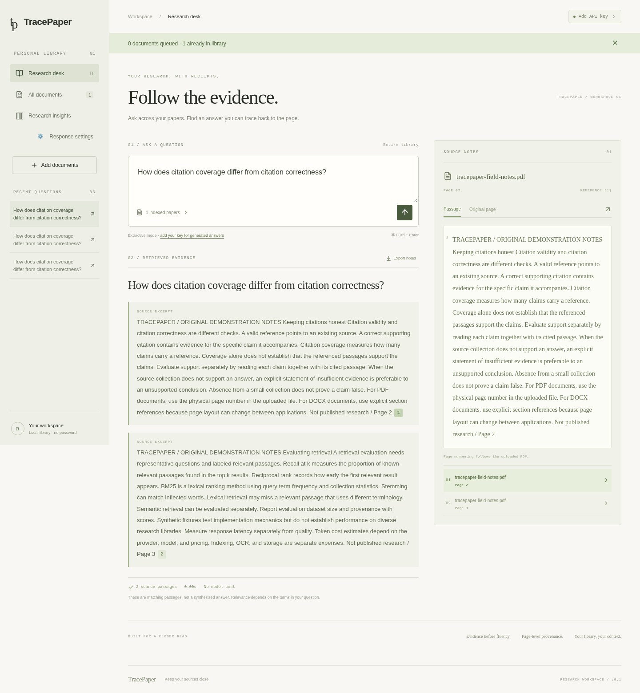

# TracePaper

A personal research workspace for asking questions across documents and following the evidence back to its source. React + TypeScript, FastAPI, SQLite FTS5, and optional Gemini or OpenAI generation. Dark navy navigation and white reading surfaces.



## What works

- Multi-file PDF and DOCX uploads, duplicate detection, persistent indexing status, and actionable parsing errors.
- Disk-backed BM25 retrieval with stemming and overlapping, page-contained passages; query the entire library or selected documents.
- PDF page citations, original PDF viewer, DOCX section references, source inspection, saved questions, and Markdown export.
- Optional grounded generation with validated citation IDs, measured latency, usage, and estimated default-model cost. Without a key, explicitly labeled retrieved excerpts.
- Responsive editorial interface; password-protected private deployment; persistent Docker volume.

## Run locally

Requirements: Linux with Python 3.12+, Node 24+, and SQLite with FTS5 (standard Python builds include it), or Docker.

```sh
python -m venv .venv
.venv/bin/pip install -r requirements.lock
npm --prefix web ci
npm --prefix web run build
.venv/bin/python -m uvicorn backend.main:app --host 0.0.0.0 --port 8000
```

Open the app on port 8000. For frontend hot reload, run `npm --prefix web run dev` alongside the backend. Vite proxies `/api` to port 8000. Rebuild the frontend before using the single-server production mode.

The app reads environment variables, not `.env` automatically. Use your process manager or hosting provider to inject settings (see `.env.example`). Never expose a private library without `TRACEPAPER_PASSWORD` and HTTPS. Local mode intentionally works without credentials. Password cookies expire after one day; changing the password invalidates sessions. This is a single-owner workspace, not multi-user isolation.

For a safe first example, upload `examples/tracepaper-field-notes.pdf` and ask “How does citation coverage differ from citation correctness?” These are original demonstration notes, explicitly not published research. Regenerate with `.venv/bin/python scripts/create_sample.py`.

## Each visitor uses their own API key

[View the response settings dialog](docs/response-settings.png).

Open **Response settings** in the sidebar or **Add API key** in the header. Choose Google Gemini or OpenAI, enter your own key, and select **Use key for this tab**. Without a key, document retrieval returns source excerpts without a model call. Invalid, exhausted, or blocked keys produce an explicit fallback notice; visitors can update or remove their key from the same dialog.

The key is held only in React memory in that tab. The app does not write it to localStorage, sessionStorage, cookies, the document database, or answer history. Refreshing the page, removing the key, or signing out clears it. Visitors re-enter it after a refresh. An answer request sends the key to TracePaper in an `X-Provider-Key` header; the backend uses it only for that request, forwarding it to the selected provider's fixed HTTPS endpoint. The provider receives the question and retrieved passages. Provider usage charges and quotas apply to that visitor's account. Use HTTPS and configure proxies/APM not to record sensitive request headers; the application does not log keys.

Server-side `OPENAI_API_KEY`, `GEMINI_API_KEY`, and `TRACEPAPER_GEMINI_KEY` are intentionally ignored. There is no shared owner-key fallback. Deployment does not require a model API secret. If an earlier cloud draft still lists `TRACEPAPER_GEMINI_KEY`, delete that obsolete requirement in environment settings; the additive draft tool cannot remove it. Old `TRACEPAPER_PROVIDER` and `TRACEPAPER_MODEL` environment entries are also unused.

Default models are Gemini `gemini-3.8-flash` and OpenAI `gpt-4.1-mini`. Set optional non-secret `TRACEPAPER_GEMINI_MODEL` / `TRACEPAPER_OPENAI_MODEL` overrides for models available to your visitors. Gemini follows the native REST API at `generativelanguage.googleapis.com` using an `x-goog-api-key` header. OpenAI uses `api.openai.com`. Both outbound destinations must be allowed by your hosting environment. Provider tests use synthetic credentials and mocked responses; live generation requires a visitor to enter a valid key.

This provides separate per-tab credentials, **not user accounts or private per-user libraries**. People with access to the same workspace still share its documents and saved answers. Keep the library password for a private workspace; use only public, non-sensitive sample documents in a recruiter demo. Add authentication and tenant-isolated storage before hosting private libraries for unrelated users.

## Deploy

For the free Hugging Face + Supabase setup, follow [the free deployment guide](docs/free-deployment.md). You can add credentials in GitHub **Settings → Secrets and variables → Actions** and run **Actions → Deploy TracePaper**, without entering credentials in Codex environment settings. This mode keeps originals, passages, and history in Supabase; a sleeping or restarted container does not own the only copy. Local SQLite remains available for development and persistent-volume deployments. The Docker image runs as UID 1000 for Spaces compatibility.


`render.yaml` defines a single Docker web service with a persistent 10 GB disk and a generated library password. Connect this repository in Render and create a Blueprint, or use [Deploy to Render](https://render.com/deploy?repo=https://github.com/anerudhh/TracePaper). Review its paid service/disk pricing before deploying. No provider secret is needed at deployment; each visitor enters their own key in the app. Retrieve the generated library password from the provider's environment settings. Do not expose it in your resume or repository.

Alternatively:

```sh
docker build -t tracepaper .
# Set TRACEPAPER_PASSWORD securely in your shell first.
docker run --rm -p 8000:8000 -v tracepaper-data:/data \
  -e TRACEPAPER_PASSWORD tracepaper
```

Terminate HTTPS at your host or reverse proxy. Run **one application worker and one replica**: SQLite and the in-process ingestion queue share local disk. Files, index, and history live under `TRACEPAPER_DATA`. Back up the volume (including SQLite consistently using its backup API), restrict access, and do not use an ephemeral filesystem for deployed data. A public recruiter demo should use non-sensitive documents in a separate instance; do not share a personal library password. There is no anonymous read-only mode yet.

### Optional OCR

On a machine with Tesseract and English language data installed, set `TRACEPAPER_OCR=1`. Pages without readable text are OCRed through PyMuPDF. The default image does not install the Tesseract language data; install it in a derived image or use the host setup. English OCR was tested in the cloud environment. OCR quality on complex scans, math, and tables varies.

## Validation

```sh
.venv/bin/python -m pytest -q
npm --prefix web run build
# Starts its own server with an isolated temporary library:
npm --prefix web run test:e2e
```

Browser tests start a separate server on port 8123 with a new temporary library, never the development library. They use `/usr/bin/chromium` if installed; otherwise run `cd web && npx playwright install --with-deps chromium` once, or set `CHROMIUM_PATH` to an installed Chromium executable. They upload the included demo files into their temporary library. They cover upload, retrieval, citation inspection, PDF page URL, export, document selection, mobile overflow, and browser errors. Backend tests use isolated temporary databases and cover PDF/DOCX indexing, source-page retrieval, history persistence, deletion, filtering, invalid uploads, authentication, origin checks, and model response validation/fallback. Provider calls are mocked; live generation requires a visitor-provided key. BYOK tests verify per-request credential isolation, ignoring server-owned keys, no persistence in SQLite/history or browser storage, replacement/removal, refresh clearing, and safe provider failure handling.

## Architecture and honest limits

The browser calls same-origin `/api` endpoints. `TRACEPAPER_STORAGE=local` (default) uses SQLite/local files; `TRACEPAPER_STORAGE=supabase` uses private Supabase object storage and service-only PostgreSQL RPCs. Hosted mode fails if its credentials/schema are missing; it does not silently fall back to ephemeral storage. An ingestion coordinator starts one isolated parser subprocess at a time and writes overlapping 230-word passages (180-word stride) to SQLite. Each parser is limited to 256 MiB address space, 120 seconds of CPU time, and 180 seconds wall time; failures are recorded without taking down the API. Worker processes receive only basic runtime/OCR settings and no provider credentials. FTS5 ranks matching chunks with BM25, selecting up to six distinct pages or sections. A restart recovers queued/interrupted jobs. The selected provider (Gemini or OpenAI) receives only the question and selected retrieved passages, not the entire file; without a visitor key, no provider request is made. Generated claim IDs are validated against retrieved passages. Valid IDs do **not** establish factual support; check each cited passage.

The index and paginated library avoid full-library memory scans. This is not yet a distributed million-paper system: indexing jobs share one host, uploads are limited to 50 MB and PDFs to 2,000 pages each, extracted text is limited to 20 million characters per document, and semantic embeddings/reranking are not implemented. BM25 can miss paraphrases and can return weak keyword matches; extractive mode presents these as passages, not asserted answers. There is no measured citation correctness score, production load-test claim, or published research benchmark. Test fixtures demonstrate mechanics only.

PDF page numbers refer to the physical uploaded file. DOCX has no stable rendered pages; citations use numbered text sections. DOCX paragraph and table extraction does not preserve all original layout. References to charts and images may be absent from text extraction.

OpenAI gpt-4.1-mini cost estimates use $0.40/M input and $1.60/M output tokens; check current provider pricing. Gemini and custom-model costs are marked unavailable rather than guessed. Gemini prompt, candidate, thinking, and total token counts are recorded when supplied by the API. Authentication is a simple shared-owner password: add rate limiting at your reverse proxy, SSO, quotas, and tenant isolation before a wider public launch. Uploaded files are untrusted: the app limits upload/expanded DOCX size, but parsing runs in resource-limited subprocesses, but further production hardening should add workload quotas and OS-level sandboxing.

Next substantive milestones: a labeled research Q&A evaluation set (retrieval recall/MRR and human-scored citation support), semantic/hybrid retrieval, OS-level parser sandboxing, and a read-only portfolio demo. Treat the current design as the first reviewable prototype.

Run `.venv/bin/python scripts/evaluate.py` to reproduce the small synthetic retrieval check; the current run is recorded in [docs/evaluation.json](docs/evaluation.json). Its three labeled questions with 10,000 distractors are deliberately limited and must not be presented as a real-world research benchmark. The latency is a local observation, not a service-level guarantee.

PyMuPDF is offered under AGPL/commercial terms. Review its upstream license obligations before distributing or operating a modified proprietary service; no project license has been chosen for you.

## Release validation

See [docs/validation.md](docs/validation.md) for current verification and explicit limitations. GitHub Actions repeats backend tests, retrieval fixtures, the production build, browser tests, and dependency audits on pushes and pull requests. `npm --prefix web run format:check` checks frontend formatting. A passing automated suite does not validate an unconfigured live provider account or a hosting deployment.
